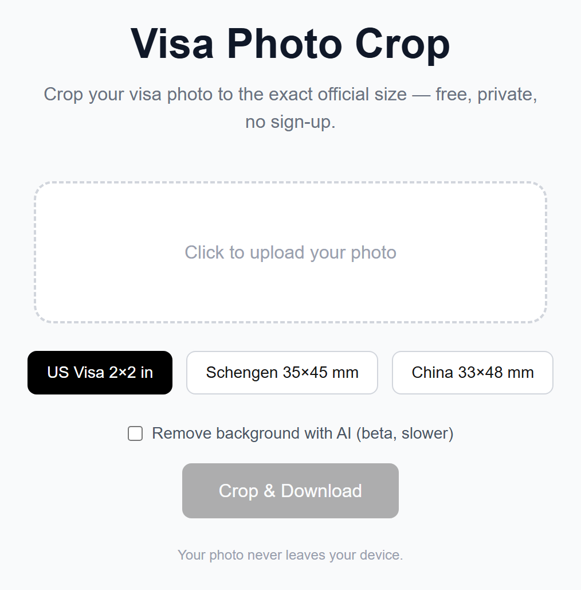

<div align="center">

# Visa Photo Crop

**Crop your passport / visa photo to the exact official size — free, private, no sign-up.**

<a href="https://visa.anhaoxie.com"></a>
<a href="LICENSE"></a>




</div>

---

## Why this exists

A compliant ID photo from a pharmacy or photo shop costs **$10–17**. The free tools online
are usually ad-choked, force you to sign up, and still leave you guessing whether the output
matches the pixel requirements your embassy actually enforces.

Visa Photo Crop does one thing: **turn a selfie into a pixel-exact, officially-sized photo,
entirely inside your browser.**

## Features

- **Three official specs** baked in, with the correct aspect ratio and output pixels
- **Face-alignment oval guide** positioned to each spec's official head-height ratio
- **Drag & zoom that can't break the frame** — the photo is clamped so it always covers the
  crop area, which makes it impossible to export a photo with blank edges
- **Optional AI background removal** composited onto a pure white background
  (beta — the first run downloads a model, so it is slower)
- **Exact-pixel JPEG export** at quality 0.95
- **No upload, no account, no ads** — see [Privacy](#privacy-by-architecture)

## Supported specs

| Spec | Physical size | Output pixels |
| --- | --- | --- |
| US Visa | 2 × 2 in | 600 × 600 |
| Schengen | 35 × 45 mm | 413 × 531 |
| China | 33 × 48 mm | 390 × 567 |

## Privacy by architecture

There is no backend. The image is read with `URL.createObjectURL`, drawn to a `<canvas>`,
cropped, and encoded to a JPEG blob that is downloaded straight from memory. Background
removal runs through [`@imgly/background-removal`](https://github.com/imgly/background-removal-js),
which executes an ONNX model via `onnxruntime-web` **in the browser**.

Nothing is ever sent to a server, because there is no server to send it to.

## Tech stack

- **Next.js 16** (App Router, Turbopack) + **React 19**
- **TypeScript**
- **Tailwind CSS v4**
- **@imgly/background-removal** + **onnxruntime-web** for in-browser background removal
- Deployed on **Vercel** behind the custom domain `visa.anhaoxie.com`

## Getting started

```bash
git clone https://github.com/anhaoXie/visa-photo-tool.git
cd visa-photo-tool
npm install
npm run dev
```

Open <http://localhost:3000>.

```bash
npm run build   # production build
npm run lint    # eslint
```

## Project structure

```
app/
  page.tsx            the whole tool: spec table, crop canvas, drag/zoom maths, export
  layout.tsx          root layout + metadata
  globals.css         Tailwind entry
  bg-test/page.tsx    isolated spike that proved @imgly/background-removal works
                      in-browser, before it was wired into the main tool
docs/
  screenshot.png      the image at the top of this README
PRODUCT.md            the v0.1 product draft: target user, pain point, scope cuts
```

`PRODUCT.md` is kept on purpose — it is the written product reasoning behind v1, including
the features that were deliberately cut from it.

## Roadmap

- [x] v0.1 — specs, crop frame, exact-pixel export
- [x] Face-alignment oval guide
- [x] Custom domain
- [x] In-browser AI background removal (beta)
- [ ] Print-sheet layout (several copies on one 4×6 page)
- [ ] Batch processing
- [ ] More country presets
- [ ] Automated checks against official head-height rules

## 中文说明

自助办签证 / 护照要交合规证件照，去照相馆或药店得花 $10–17；网上的免费工具又满是广告、
强制注册，而且搞不清各国官方到底要求多少像素。

**这个工具只做一件事：在浏览器里把自拍变成像素精确、符合官方规格的证件照。**

- 内置美签 / 申根 / 中国三种官方规格，宽高比与导出像素都按官方要求写死
- 椭圆参考线按各规格的官方头部比例定位，照着把脸摆进圈里即可
- 拖动和缩放做了 clamp，照片永远不会被拖出裁剪框，不可能导出带空边的废图
- 可选 AI 去背景并合成纯白底（beta，首次要下载模型所以偏慢）
- **照片全程不出浏览器**——没有后端，没有账号，没有广告

在线使用：<https://visa.anhaoxie.com>

## License

[MIT](LICENSE) © anhaoXie
